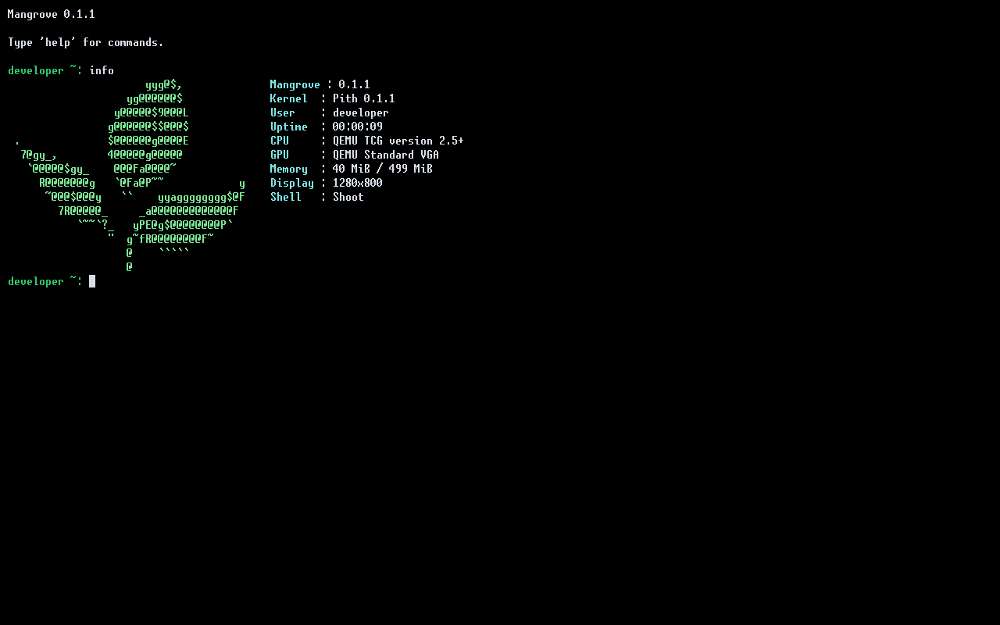

# Mangrove

Mangrove is an operating system for x86-64 computers, written primarily in C.
It has its own UEFI bootloader, Pith kernel, C library, and native userspace.
It does not use Linux or another existing kernel. The aim is to build a usable
desktop operating system.



## Features

- UEFI boot and native Ring 3 processes, with syscalls, virtual memory,
  scheduling, IPC, and process management.
- USB and block storage, GPT, a VFS, and MGFS, FAT32, and exFAT filesystems.
- Shoot shell, Reed text editor, and services for devices, volumes, sessions,
  identity, logging, and networking.
- Ethernet and IPv4 networking with ICMP, UDP, TCP, DNS, and DHCP. Current PCI
  network drivers support E1000 and RTL8168 devices.
- A native C library with a bounded GNU C17 subset; it is not a complete hosted
  C17 implementation.

## Building

The build uses GCC, GNU binutils, and MinGW-w64. Linux uses the host GNU tools
for ELF targets. macOS uses Homebrew GNU Make (`gmake`) and the
`x86_64-elf` cross-toolchain. See the [Linux](documentation/development/linux.md)
and [macOS](documentation/development/macos.md) setup instructions.

```sh
make -B -j4 binaries
make fresh-image
make usb-image
make run
```

Use `gmake` instead of `make` on macOS. `make fresh-image` recreates the
persistent development image; `make usb-image` writes
`build/Mangrove/MangroveUSB.img`. `make run` boots the development image in
QEMU with OVMF. Linux uses KVM; macOS selects its platform accelerator.

## Testing

Mangrove Test Suite (MTS) runs host tests, MFQS filesystem qualification,
native guest programs, QEMU runners, and independent media checkers.

```sh
make test
make test-guest
```

`make test` runs the host profile. `make test-guest` runs the standard QEMU
guest profile. QEMU testing does not qualify physical hardware, SMP, or
power-loss behavior. See the [MTS documentation](documentation/development/test-suite.md).

## Documentation

See the [documentation index](documentation/README.md).

## License

Project-owned source is licensed under GPL-3.0-or-later; see [LICENSE](LICENSE).
Third-party data and assets retain their own licenses and provenance.
